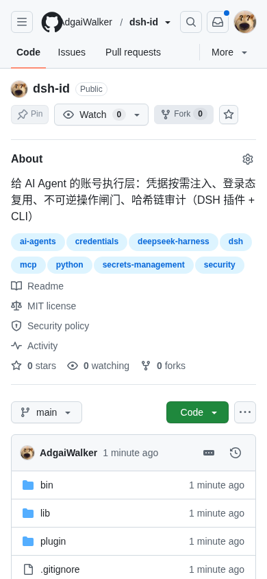

# dsh-id

给 AI Agent 用的账号执行层：**凭据值不落明文、不进日志、不进对话**，AI 却能自主用你的账号干活。

为 [DeepSeek Harness](https://github.com/deepseek-ai) 生态写的，纯本地、无服务端、无遥测。



---

## 解决什么问题

AI 要用你的账号，只有三种做法：

| 做法 | 问题 |
| --- | --- |
| 把 token 贴进对话 | 之后每一次请求的输入里都有它，永久泄露 |
| 把 token 写进 `.env` | 任何同机进程 `cat` 一下就有 |
| 让 AI 每次找你要密码 | 你变成人肉 2FA，一天被打断十次 |

`dsh-id` 走第四条：**凭据只在该用的那一瞬间、只在该用的那个进程里解开**，其余时间磁盘上只有密文。

```bash
dsh-id exec github-pat https://api.github.com/user
```

这条命令执行完，明文就消失了。它不在命令行参数里（`ps` 看不到）、不在日志里、不在对话里。

---

## 五个能力

| 命令 | 干什么 |
| --- | --- |
| `dsh-id exec` | 按需注入凭据，发一次 HTTP 请求或跑一条命令，结束即失效 |
| `dsh-id session` | 网页登录态：**登录一次**存下 cookie/localStorage，之后直接是登录态（2FA 只过一次） |
| `dsh-id creds` | 凭据增删、轮换、租约、作用域、归档、`panic` / `restore`、审计校验与机外锚 |
| `dsh-id guard` | 不可逆操作闸门：删除/转账/发布这类动作先记一条待批准 |
| `dsh-id panel` | 本机网页面板（127.0.0.1:8791）：看账号/会话/审计，增删改凭据 |
| `dsh-id` | 不带参数：一屏状态（凭据数、会话数、审计链、待审批） |

v0.3.0 起只有两个真命令：`dsh-id`（伞形入口）和 `dsh-id-panel`（面板服务）。
PATH 上另留 3 个兼容壳：`vault-exec` / `vault-session` / `vault-login` 都直接转发到 `dsh-id`。
`vault-proxy`、`accounts`、`vault-cred`、`vault-guard` 已删除（前者是已废弃的常驻代理，后三个并入了 `dsh-id`）。

---

## 安装

### 方式一：当 DSH 插件装（推荐）

仓库根目录就是一个 DSH bundle（`package.json` + `cordis.patch.yml`）。在 DSH 里让 Agent 执行：

```text
plugin_manager install_bundle  github:AdgaiWalker/dsh-id
```

或手工装进 profile：

```bash
cd ~/.dsh/profiles/web
pnpm add github:AdgaiWalker/dsh-id
```

装好后在「设置 → 插件」里能看到 `dsh-id`。工具能力取决于机器上有没有装下面的 CLI。

### 方式二：只要命令行

需要：Linux / Python 3.10+ / `openssl`。

```bash
git clone https://github.com/AdgaiWalker/dsh-id ~/dsh-id
cd ~/dsh-id
./install.sh                 # 拷到 ~/.local/{bin,lib}，建数据目录
dsh-id                       # 看状态（首次会提示还没有凭据）
```

`install.sh` 只做三件事：拷文件、`chmod 755`、建数据目录。它不启动任何常驻服务。

### 目录结构

```text
package.json  cordis.patch.yml  lib/   ← DSH bundle 本体
cli/bin/  cli/lib/                     ← 2 个真命令 + 3 个兼容壳 + 两个 Python 库
cli/lib/dsh-id/                        ← 内部实现（creds/guard/exec/session/login）
docs/plugin.md                         ← 插件安装与工具清单细则
install.sh  test.sh                    ← 装 CLI / 冒烟测试
```

---

## 用法

### 存一个凭据

```bash
dsh-id creds add github-pat bearer --domains api.github.com
# bearer / basic / header / query 四种注入方式；totp 是另一类（见下）
# 交互输入值，不回显；写入后磁盘上是密文（0600）
```

### 用它发请求

```bash
dsh-id exec github-pat https://api.github.com/user
dsh-id exec github-pat https://api.github.com/repos/me/repo -X POST -d '{}'
# HTTP >= 400 默认退出码 22（便于判成败）；加 --allow-http-error 仍返回 0

# 也可以把明文注入子进程环境变量，跑任意命令
dsh-id exec run github-pat -- sh -c 'curl -H "Authorization: Bearer $VAULT_SECRET" https://api.github.com/user'
```

域名不在该凭据的白名单里 → 直接拒绝，退出码 4。

### 让 AI 自己登录（账号密码 + 2FA）

```bash
dsh-id login github --url https://github.com/login \
  --cred github-login --totp github-totp        # 有 COOKIE 就打，无则人工接手

# 凭据怎么存：
dsh-id creds add github-login basic  --domains github.com     # 值填 user:pass
dsh-id creds add github-totp  bearer --domains github.com --lease-days 0   # 值填 base32 种子
```

流程：打开登录页 → 填账号密码 → 提交 → 认出 2FA 框就用 TOTP 算码填入 → 启发式确认已登录 →
自动 `storage_state` 加密存成会话（`vault-session use <名字>` 复用）。每步截图落
`~/.deepseekbot/vault/shots/`，失败时看截图定位。

没有 TOTP 种子时加 `--manual-2fa`：窗口留给你手工过验证码，脚本等你。

### 存一个网页登录态

```bash
dsh-id session save github --url https://github.com/login --ttl-days 30
# 开可见窗口，你手动登录完回车；默认 7 天（到期有登录档案就自动重登）
dsh-id session list                                          # 域名、保存时间、过期时间
dsh-id session use github --headless                         # 打开就是登录态
dsh-id session check github                                  # 探一次，判断是否还有效
```

## 第二因素（totp）与它的边界

```bash
dsh-id creds add github-totp totp                    # 值填 base32 种子；不需要白名单
dsh-id login github --url https://github.com/login --cred github-login --totp github-totp
```

totp 是独立一类：**不能 exec、不发网络请求、没有租约**（作废一个种子等于把账号锁死）、
面板只显示「有没有、上次用过没有」，值永不回显。

**它不是「更安全」。** 种子和密码存在同一个库里，同一把机器钥匙都能解开——那是一个因素、
两种存法。它买到的是**自动化**（不用你在旁边报码），不是第二道防线。

登录有失败熔断：TOTP 允许 1 次 ±1 时间步的时钟补偿，被拒即停并熔断该账号（连错 2 次不再试），
避免撞平台风控或锁号。

## 银行卡（card）

```bash
# 交互：卡号、CVV 不回显；有效期/持卡人/账单地址照填
dsh-id creds add 招行visa card

# 非交互（脚本/测试）：stdin 前两行是卡号、CVV，其余走参数
printf '4242424242424242\n123\n' | dsh-id creds add visa card \
  --holder "ZHANG SAN" --expiry 12/28 --billing "1 Main St"
```

card 是独立一类，**不能 exec、没有租约**：卡号与 CVV 在密文里（JSON 两字段），
有效期/持卡人/账单地址/尾号/品牌进 meta 供列表显示。面板永远只显示尾号，
`creds list` 不打印完整卡号。

## 面板里出 TOTP 码（只限本机）

面板的「出码」按钮只接受**本机直连**。判据三条同时满足才给码：

1. `Host` 是 `127.0.0.1` / `localhost` / `::1`；
2. 没有 `CF-Connecting-IP`；
3. 没有 `X-Forwarded-For`。

只查 Host 不够：经 testsite/cloudflared 反代进来时 Host 会被改写成 `127.0.0.1:<port>`，
所以必须靠两个代理头判断。拒绝时返回 403 并写一条 `panel_totp_denied` 审计（记原因，不记码）。

## 作用域：域名之外，还管「能做什么」

域名白名单只回答「能发给谁」。拿到 `github-pat` 仍然可以 `-X DELETE /repos/...`：

```bash
dsh-id creds scope github-pat --methods GET,POST --paths /repos/,/user
# 越界：exit 9，并告你怎么开口子
```

没设作用域的老凭据保持向后兼容，`dsh-id doctor` 会把它们列成「未收紧」。

## 账实一致与机外锚

```bash
dsh-id creds adopt                          # 老格式裸密文入索引（只补元数据，不重新加密）
dsh-id creds audit anchor --out ~/锚.json    # 导出链头，放到机外
dsh-id creds audit verify --anchor ~/锚.json # 能识别「截断」与「重写」
```

审计链防误改，但同权限者可以整链重算。机外锚是唯一真正的见证：它记下行数与链头，
之后无论补写多少行，前 N 行都必须对得上。

### 出事的时候

```bash
dsh-id creds panic --dry-run    # 先看会做什么（顺带预览待吊销清单）
dsh-id creds panic              # 停服务 + 禁用自启 + 隔离密文 + 生成待吊销清单
dsh-id creds restore            # 一条命令回来（自动找最新隔离目录）
dsh-id creds revoke-list        # 随时重生成：哪些 token/会话在平台上还没停
```

`panic` 只隔离本地密文——**上游的 token、已经打开的网页会话都还活着**。
所以 panic 会同时问你一件更重要的事：**去哪吊销**。

```text
【上游还没停】
  ⚠ 1 个凭据 + 7 个会话在平台上依然有效，panic 管不到
  清单: ~/.deepseekbot/vault/.panic-<时间戳>/REVOKE.md
  - GitHub       github-pat  →  https://github.com/settings/tokens
  - ChatGPT 会话  chatgpt     →  https://chatgpt.com/#settings/Security
  - Google 会话   google      →  https://myaccount.google.com/deviceactivity
```

清单里只有名字和域名，没有任何凭据值；认识的平台直接给吊销/登出链接，
不认识的就写「去该平台后台删」。恢复后清单留档为 `REVOKE-<时间戳>.md`。

`panic` 不会删你的密钥文件——密文被挪进 `.panic-<时间戳>/`，随时可恢复。

## DSH 插件

仓库根目录就是 bundle，把上面这些能力包成工具交给模型：

- 4 个只读工具（含 `account_vault_panel`：确保面板在跑并给出地址）：凭据/会话**元数据**、安全边界说明
- 4 个执行工具：带凭据发请求、用会话开浏览器、浏览器操作、关浏览器
- v0.3.0 减掉 5 个只读工具（总览/账号列表/单账号/审批队列/审计链）：它们都能用 `dsh-id doctor`、`creds list`、`creds audit verify` 直接看到，没有必要各占一个工具
- 全部工具都不返回凭据值；截图只返回文件路径，不返回 base64

细则见 [`docs/plugin.md`](docs/plugin.md)。它与 CLI 解耦，不装插件也能用命令行。

---

## 防封号：频率与熔断

Agent 用你的账号干活，最容易出事的是**节奏不像人**。guard 带一层按账号计的限额：

```bash
dsh-id guard check "发一条帖子" --scope x-main     # allow / throttled(exit 11)
dsh-id guard record "发一条帖子" --scope x-main     # 记一次成功（今日 +1，重置连续失败）
dsh-id guard record "发一条帖子" --scope x-main --fail   # 记一次失败
dsh-id guard reset --scope x-main                 # 查清原因后手动恢复正常时
```

默认（`guard-rules.yaml` 的 `rate_limits`，可改）：发帖 **3 条/天**、两次之间至少 **30 分钟**、连续失败 **2 次**自动熔断。

```text
$ dsh-id guard check "发一条帖子" --scope x-main
throttled
  原因:    距上次太近，还需等 30 分钟
  规则:    publish  {'max_per_day': 3, 'min_interval_minutes': 30, ...}
  ⚠ 先别做。等一会儿、或换账号、或查清失败原因后 dsh-id guard reset
exit=11
```

这只是降低概率，**不保证不封**。真封了：删会话重登、`creds panic` 吊销、换账号，系统照常。

## 维护通道（哪里错了能改）

| 通道 | 怎么用 |
| --- | --- |
| 自检 | `dsh-id doctor` / `dsh-id doctor --json`（把输出贴进 issue 即可，无凭据值） |
| 版本 | `dsh-id version`；面板顶部显示版本，「检查更新」读 GitHub 最新 release |
| 运行日志 | `<vault>/logs/dsh-id-YYYY-MM-DD.log`，按天保留 14 天，只记动作/名字/主机/结果 |
| 反馈 | 面板「报告问题」一键生成脱敏 issue，或直接开 [Issue](https://github.com/AdgaiWalker/dsh-id/issues/new/choose) |
| 仓库 | 面板「仓库」「文档」直达；`CHANGELOG.md` 记每次改了什么 |

日志长这样（不含 URL，不含值）：

```json
{"ts":"2026-11-16T18:10:06","action":"panel_check_update","ok":true,"msg":"已是最新 0.1.0"}
```

## 安全模型：它挡什么，挡不住什么

**设计上做到的**

- 磁盘上永远是密文（`openssl enc` / AES-256-CBC），密钥单独存放、权限 600
- 明文只在目标进程的环境变量里短暂存在，不进 argv、不进日志、不进对话
- 每次操作写审计（每行带 `prev_hash` + `hash`）
- 域名白名单：凭据只能用在登记过的主机上
- `panic` 一条命令让 AI 立刻失去全部凭据能力
- 会话文件加密存储，权限 600

**做不到的（请当它是「限制」，不是「隔离」）**

- **同用户的其他进程仍可读密钥文件**。这不是安全沙箱，是防手滑和防日志泄露的工程措施。真要隔离，得换用户/容器的边界。
- **审计哈希链防不住同权限重写整条链**，也发现不了尾部截断。它能让「改一行」这种篡改留下痕迹，仅此而已。机外锚（`audit-anchor`）能补上「截断/重写」这一块，但前提是那枚锚真的存到了机外。
- **`guard` 是关键词闸门，不是强制审批**。`approve --who` 由调用方填写，不能当作真实审批签名；模型也可以绕开它直接调用底层命令。
- **`panic` 只隔离本地密文**：它不会吊销上游已经发出的 token，也不会终止别人已经打开的网页会话。真要止血，还得去平台后台 revoke。
- **会话「过期时间」是本地 TTL**，不代表站点侧真的还有效。`session check` 是启发式探测，结果是参考不是保证。
- 机器绑定自动解锁意味着：**能在这台机器上以这个用户身份跑代码的人，就能解密**。这是刻意的取舍（AI 要自主干活），不是疏忽。
- **把 TOTP 种子存进同一个库，2FA 就不再是第二道防线**。它变成「一个因素、两种存法」，换来的是自动化。这不提高安全性，只提高便利性。
- **作用域对老凭据默认不收紧**，`doctor` 会列出来；不设就一直是用域名白名单兜着。

这些边界在 `dsh-id creds status` 和插件的 `*_security_boundary` 工具里也如实标着。

---

## 现状与未完成

- 主密码默认关闭，用机器绑定自动解锁（`creds passwd` 可开启，作为可选加强项）
- 插件是「只读状态 + 执行能力」MVP，不是登录执行器；设置卡片是否可视化取决于 DSH 版本
- 只做了 Linux；`vault-session` 依赖 Chromium/Playwright
- 没有做多用户、没有做远程同步、没有做团队共享

---

## 兼容性

- Python 3.10+（标准库 + `openssl` 命令行，无第三方依赖）
- 插件针对 DSH `0.2.2-rc.1` 开发，devDependencies 见根目录 `package.json`
- 在 Arch Linux / Omarchy 上实测

---

## License

MIT，见 [LICENSE](LICENSE)。安全问题怎么报见 [SECURITY.md](SECURITY.md)。
